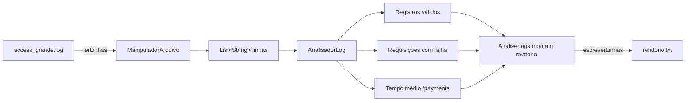

# 📊 Analisador de Logs de Servidor – Leitura e Escrita de Arquivos em Java

Aplicação em **Java** (linha de comando) que lê um arquivo de log de acessos de um servidor, valida cada registro, identifica as requisições que falharam, calcula o tempo médio de resposta do endpoint de pagamentos e **grava um relatório** em arquivo de texto.

O projeto foi feito como atividade prática de **leitura e escrita de arquivos**, e aproveita para aplicar boas práticas de organização: **interface**, separação de responsabilidades e tratamento de exceções.

---

##  Sumário

- [Sobre o projeto](#-sobre-o-projeto)
- [O que o programa faz](#-o-que-o-programa-faz)
- [Tecnologias utilizadas](#-tecnologias-utilizadas)
- [Estrutura do projeto](#-estrutura-do-projeto)
- [Arquitetura e classes](#-arquitetura-e-classes)
- [Fluxo de execução](#-fluxo-de-execução)
- [Formato do arquivo de log](#-formato-do-arquivo-de-log)
- [Regras de validação](#-regras-de-validação)
- [Formato do relatório](#-formato-do-relatório)
- [Como executar](#-como-executar)
- [Exemplo com o log de teste](#-exemplo-com-o-log-de-teste)
- [Resultado com o log grande](#-resultado-com-o-log-grande)
- [Tratamento de erros](#-tratamento-de-erros)
- [Possíveis melhorias](#-possíveis-melhorias)
- [Autor](#-autor)

---

## Sobre o projeto

Servidores web e APIs registram cada requisição recebida em arquivos de log. Quando o volume é grande, analisar esses arquivos manualmente é inviável. Este projeto automatiza uma análise básica:

1. lê todas as linhas do log;
2. descarta registros mal formatados;
3. separa as requisições que terminaram com erro (código HTTP **400 ou superior**);
4. calcula o **tempo médio de resposta** do endpoint `/api/v1/payments`;
5. escreve tudo em um **relatório** de texto.

---

## O que o programa faz

| Análise | Descrição |
|---------|-----------|
| **Registros válidos** | Conta quantas linhas do log estão no formato esperado. |
| **Requisições com falha** | Lista as requisições com código de status **≥ 400** (erros de cliente e de servidor). |
| **Tempo médio de `/api/v1/payments`** | Calcula a média do tempo de resposta (em ms) das requisições a esse endpoint. |
| **Relatório** | Salva o resultado em `relatorio.txt`. |

---

## Tecnologias utilizadas

- **Linguagem:** Java (100% do código)
- **API de arquivos:** `java.nio.file` (`Files.readAllLines`, `Files.write` e `Paths.get`)
- **Coleções:** `List` e `ArrayList`
- **Recursos da linguagem:**
  - Interfaces (`IAnalisadorLog`)
  - Tratamento de exceções (`IOException`, `NumberFormatException`)
  - Manipulação de `String` (`split`, `trim`, `endsWith`, `replace`, `String.format`)
- **Entrada e saída:** arquivos de texto (`.log` e `.txt`)
- **Dependências externas:** nenhuma (apenas a biblioteca padrão do Java)

---

## Estrutura do projeto

```
Atividade_LeituraEscritaArquivos/
├── AnaliseLogs.java        # Classe principal (main): orquestra leitura, análise e escrita
├── ManipuladorArquivo.java # Leitura e escrita de arquivos
├── IAnalisadorLog.java     # Interface que define as análises disponíveis
├── AnalisadorLog.java      # Implementação das análises sobre as linhas do log
├── access_exemplo.log      # Log pequeno (9 linhas) para testes rápidos
├── access_grande.log       # Log grande, usado como entrada padrão do programa
├── relatorio.txt           # Relatório gerado pela execução
└── README.md
```

---

## Arquitetura e classes

O projeto separa **o que lê/escreve arquivos**, **o que analisa os dados** e **o que coordena tudo**.

### `AnaliseLogs` (classe principal)
Contém o método `main`. Define os arquivos de entrada (`access_grande.log`) e de saída (`relatorio.txt`), instancia `ManipuladorArquivo` e `AnalisadorLog`, executa as três análises e monta as linhas do relatório antes de gravá-lo. Também captura `IOException` e exibe uma mensagem amigável.

### `ManipuladorArquivo`
Responsável exclusivamente pelo acesso a disco:

| Método | Descrição |
|--------|-----------|
| `lerLinhas(String caminho)` | Lê todas as linhas de um arquivo e devolve `List<String>`. |
| `escreverLinhas(String caminho, List<String> linhas)` | Grava uma lista de linhas em um arquivo (cria ou sobrescreve). |

### `IAnalisadorLog` (interface)
Contrato das análises, independente da implementação:

```java
int          contarRegistrosValidos(List<String> linhas);
List<String> listarRequisicoesComFalha(List<String> linhas);
double       calcularTempoMedioPayments(List<String> linhas);
```

### `AnalisadorLog` (implementa `IAnalisadorLog`)
Implementa as análises. Tem ainda o método privado `linhaValida(String)`, usado por todas elas para ignorar registros inválidos.

| Método | Descrição |
|--------|-----------|
| `linhaValida` *(privado)* | Valida o formato de uma linha. |
| `contarRegistrosValidos` | Conta as linhas válidas. |
| `listarRequisicoesComFalha` | Devolve as requisições válidas com status ≥ 400, já formatadas para o relatório. |
| `calcularTempoMedioPayments` | Média dos tempos de `/api/v1/payments`; devolve `-1` se não houver dados. |

---

## Fluxo de execução



---

## Formato do arquivo de log

Cada linha representa uma requisição, com **6 campos separados por `|`**:

```
IP | data hora | método | endpoint | status | tempo
```

Exemplo:

```
192.168.1.2 | 2026-03-17 14:02 | POST | /api/v1/payments | 201 | 240ms
```

| # | Campo | Exemplo |
|---|-------|---------|
| 0 | Endereço IP | `192.168.1.2` |
| 1 | Data e hora | `2026-03-17 14:02` |
| 2 | Método HTTP | `POST` |
| 3 | Endpoint | `/api/v1/payments` |
| 4 | Código de status HTTP | `201` |
| 5 | Tempo de resposta | `240ms` |

---

## ✅ Regras de validação

Uma linha só é considerada **válida** se:

1. **não estiver vazia** (ou só com espaços);
2. tiver **exatamente 6 campos** ao ser dividida por `|`;
3. o campo de **status** (5º campo) for um **número inteiro**;
4. o campo de **tempo** (6º campo) **terminar com `ms`**.

Linhas que não atendem a essas regras (por exemplo, `registro invalido para teste`) são **ignoradas** por todas as análises, sem interromper o programa.

**Regras específicas das análises:**

- **Falha:** status **maior ou igual a 400**.
- **Tempo médio:** considera apenas registros válidos cujo endpoint seja exatamente `/api/v1/payments`, **independentemente do método HTTP**. O sufixo `ms` é removido antes da conversão para número.

---

##  Formato do relatório

O arquivo `relatorio.txt` é gerado com esta estrutura:

```
RELATORIO DE ANALISE DO SERVIDOR
================================
Registros validos processados: <total>
Requisicoes com falha: <quantidade>

FALHAS ENCONTRADAS
<data hora> | <método> | <endpoint> | <status> | <tempo>
...

TEMPO MEDIO - /api/v1/payments
<média>ms
```

> Na lista de falhas, o campo de **IP é omitido**: aparecem data/hora, método, endpoint, status e tempo.
> Se não houver nenhuma requisição ao endpoint de pagamentos, o relatório mostra a mensagem `Nao ha dados suficientes para calcular a media.`

---

##  Como executar

### Pré-requisitos

- **JDK** (Java Development Kit) instalado:
  ```bash
  java -version
  javac -version
  ```

### Passo a passo

1. **Clone o repositório:**
   ```bash
   git clone https://github.com/MoabeGuedes/Atividade_LeituraEscritaArquivos.git
   cd Atividade_LeituraEscritaArquivos
   ```

2. **Compile os arquivos:**
   ```bash
   javac *.java
   ```

3. **Execute o programa** (na pasta onde estão os arquivos `.log`):
   ```bash
   java AnaliseLogs
   ```

4. **Confira o resultado:** o arquivo `relatorio.txt` será criado (ou sobrescrito) na mesma pasta, e o terminal exibirá:
   ```
   Relatorio gerado com sucesso.
   ```

> 💡 Os caminhos dos arquivos são **relativos**, então o programa precisa ser executado a partir da pasta do projeto.

### Usando outro arquivo de log

O arquivo de entrada está definido na variável `arquivoEntrada` em `AnaliseLogs.java`. Para analisar o log pequeno de teste, troque o valor:

```java
String arquivoEntrada = "access_exemplo.log";
```

---

## Exemplo com o log de teste

O arquivo `access_exemplo.log` possui 9 linhas, sendo **uma delas inválida de propósito**:

```
192.168.1.1 | 2026-03-17 14:00 | GET    | /api/v1/users    | 200 | 150ms
192.168.1.2 | 2026-03-17 14:02 | POST   | /api/v1/payments | 201 | 240ms
192.168.1.3 | 2026-03-17 14:04 | POST   | /api/v1/payments | 500 | 360ms
192.168.1.1 | 2026-03-17 14:06 | GET    | /api/v1/orders   | 404 | 95ms
192.168.1.4 | 2026-03-17 14:08 | GET    | /api/v1/payments | 200 | 180ms
192.168.1.5 | 2026-03-17 14:10 | DELETE | /api/v1/users/8  | 403 | 120ms
192.168.1.6 | 2026-03-17 14:12 | GET    | /api/v1/health   | 200 | 12ms
registro invalido para teste
192.168.1.7 | 2026-03-17 14:14 | POST   | /api/v1/orders   | 400 | 210ms
```

Aplicando as regras do programa, o relatório esperado é:

```
RELATORIO DE ANALISE DO SERVIDOR
================================
Registros validos processados: 8
Requisicoes com falha: 4

FALHAS ENCONTRADAS
2026-03-17 14:04 | POST | /api/v1/payments | 500 | 360ms
2026-03-17 14:06 | GET | /api/v1/orders | 404 | 95ms
2026-03-17 14:10 | DELETE | /api/v1/users/8 | 403 | 120ms
2026-03-17 14:14 | POST | /api/v1/orders | 400 | 210ms

TEMPO MEDIO - /api/v1/payments
260.00ms
```

**Conferência:** 8 linhas válidas (a linha de texto livre é descartada); 4 com status ≥ 400; e a média de `/api/v1/payments` é (240 + 360 + 180) ÷ 3 = **260,00 ms**.

---

##  Resultado com o log grande

O `relatorio.txt` versionado no repositório foi gerado a partir de `access_grande.log` e traz:

| Métrica | Valor |
|---------|-------|
| Registros válidos processados | **1000** |
| Requisições com falha | **250** |
| Tempo médio de `/api/v1/payments` | **498.25 ms** |

Os status de falha que aparecem na lista são `403`, `404`, `429` e `500`.

---

## ⚠️ Tratamento de erros

- **Arquivo de entrada inexistente ou ilegível:** o `IOException` é capturado em `AnaliseLogs` e o programa exibe `Erro: o arquivo de entrada nao foi encontrado.`
- **Linhas inválidas:** são simplesmente ignoradas pelas análises.
- **Status não numérico:** a `NumberFormatException` é tratada dentro de `linhaValida`, e a linha é considerada inválida.
- **Sem dados de pagamento:** o método devolve `-1`, e o relatório informa que não há dados suficientes.

---

## 🚀 Possíveis melhorias

- Receber os nomes dos arquivos de entrada e saída por **argumentos de linha de comando** (`args`)
- Mostrar, no relatório, **mais estatísticas**: média por endpoint, requisições por método, ranking de IPs, maior tempo de resposta
- **Agrupar falhas por código de status**
- Aceitar um **endpoint configurável** em vez de `/api/v1/payments` fixo
- Ler arquivos muito grandes com **streaming** (`Files.lines` ou `BufferedReader`) em vez de carregar tudo na memória
- Evitar repetir a lógica de `split` e `trim` em cada método, extraindo para um método auxiliar ou uma classe `RegistroLog`
- Diferenciar mensagens de erro (arquivo inexistente × erro de permissão ou de escrita)
- Escrever testes unitários (JUnit) para `AnalisadorLog`
- Incluir **filtro por data/hora**

---

## 👤 Autor

**Moabe Guedes**

Projeto desenvolvido para fins acadêmicos.
